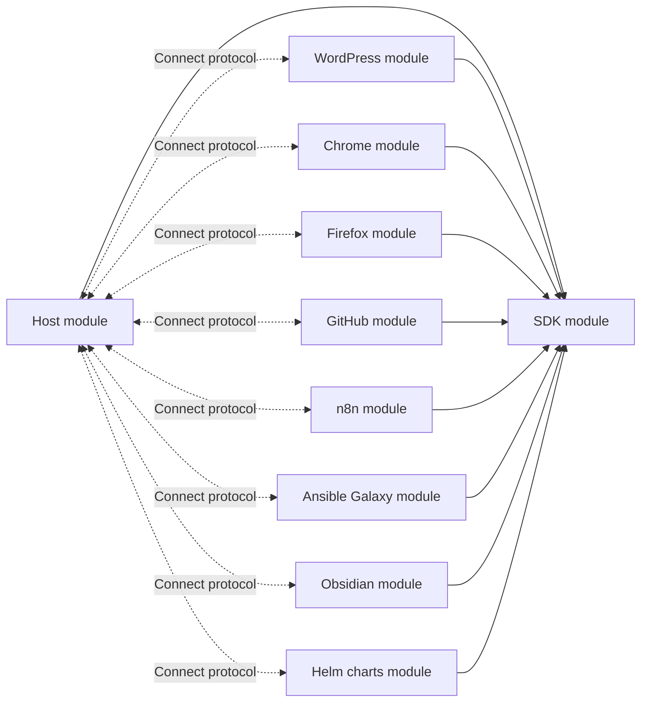

# Independently releasable registry plugins

This repository is a Go workspace, not a single Go module. Source adapters are
co-located for development but run as independent Connect services and can move
to separate repositories. The host has no compile-time adapter dependency.

| Module directory | Owns | Local library dependencies |
| --- | --- | --- |
| `.` | Host CLI, inventories, selection, engine, S3, in-memory test store | SDK |
| `sdk/` | Registry interfaces, version policy, protobuf contract, generated Connect code, client/server, HTTP/Git/npm/Artifact Hub services and retry helpers | None |
| `sources/wordpress/` | WordPress plugin and theme adapter, version history, tests, `cmd/dug-wordpress`, `cmd/dug-wordpress-themes` | SDK |
| `sources/chrome/` | Chrome adapter, tests, `cmd/dug-chrome` | SDK |
| `sources/firefox/` | Firefox adapter, tests, `cmd/dug-firefox` | SDK |
| `sources/github/` | GitHub adapter, tests, `cmd/dug-github` | SDK |
| `sources/n8n/` | n8n community nodes adapter, tests, `cmd/dug-n8n` | SDK |
| `sources/ansible-galaxy/` | Ansible Galaxy adapter, tests, `cmd/dug-ansible-galaxy` | SDK |
| `sources/obsidian/` | Obsidian adapter, tests, `cmd/dug-obsidian` | SDK |
| `sources/helm/` | Helm charts adapter, tests, `cmd/dug-helm` | SDK |
| `integration/` | Tests combining host, SDK and adapters; the GoFakeS3 test server `cmd/dug-s3local` | Host, SDK, sources under test, GoFakeS3 |



Each source has its own `go.mod`, `go.sum`, executable and adapter tests. It must
not import host `engine`, `inventory`, `services/storage` or `internal` packages, or another
source. Shared source-facing functionality belongs in the SDK. Full-system tests
live in `integration/` so source test dependencies do not pull in the host.

The SDK does not depend on S3, host selection logic, or a source. Its
`services/pluginhost` service supplies common CLI flags, signal handling, upstream
HTTP client ownership, plugin token loading, and server startup through
`plugin.Serve`. Sources declare their registry identity, default address, and
factory and provider definition, with optional hooks for source-specific flags and validation. They still
own their query options, upstream authentication, executable, and deployment.

An adapter module can implement multiple catalogs. The shared model is
`registry.Provider{ID, Registries: []registry.Definition}`, where each definition
has a stable global `ID` and a provider-local `Kind`:

| Provider | Kind | Registry ID |
| --- | --- | --- |
| `wordpress` | `plugins` | `wordpress` |
| `wordpress` | `themes` | `wordpress-themes` |
| `chrome` | `extensions` | `chrome` |
| `firefox` | `addons` | `firefox` |
| `github` | `repositories` | `github` |
| `n8n` | `packages` | `n8n` |
| `ansible-galaxy` | `collections` | `ansible-galaxy` |
| `helm` | `packages` | `helm` |

Both WordPress commands use `wordpress.Provider()`, derived from the adapter's
directory definitions. The command validates membership before startup. Each
endpoint still serves one registry and advertises its provider's catalog list
through `Info`; `plugin.Client.Provider()` exposes that metadata to callers.
The list describes the adapter's catalogs, not additional registries served by
the same endpoint. Registry IDs remain the reference, inventory, and storage
identities, so plugin and theme slugs cannot collide. Provider membership never
relaxes the client's exact registry check. The wire field is additive: older
plugins may omit provider metadata, which remains unknown rather than inferred.

Shared infrastructure lives in services packages. `sdk/services` provides
`NewDugHttpClient` for configured, reusable HTTP connection pools and
`NewDugGitClient` for repository operations. Host object storage, including S3
and the in-memory test store, lives under `services/storage`.

The Git service uses the `git` executable from PATH by default. Construct it with
`services.NewDugGitClient(services.GitClientOptions{})`, then use `Clone` (without
a working-tree checkout), `Fetch` (origin), `ResolveRevision`, and `Archive`
(streamed tar). Every operation accepts a context and defaults to a five-minute
timeout; `GitClientOptions` can override the executable and timeout. Authentication
uses Git's existing configuration, with terminal credential prompts disabled.
The GitHub adapter continues to use its REST API; it does not need a local clone.

`sdk/services/npm` is the shared client for the public npm registry, so every
source that archives npm-published packages (n8n community nodes now; Node-RED,
Homebridge or a general npm source later) reuses one implementation of package
documents, the capped search endpoint, download counts, tarball URL and name
rules, and SHA-512 integrity verification. Sources cannot import each other, which
is why the client lives in the SDK and not in `sources/n8n`.

`sdk/services/github` is the same kind of shared client for the GitHub REST
API: origin-pinned requests, token handling, primary and secondary rate-limit
waits, Link pagination, and the repository and release records. The GitHub
source and the Obsidian source (whose plugins are GitHub releases) both use it;
a future index over GitHub releases reuses it too.

`sdk/services/artifacthub` is the shared client for the Artifact Hub catalog API: the
kind-filtered search walk (with the reported total, so a truncated walk is an error),
package and per-version documents with SHA-256 digests, and name and version rules.
Artifact Hub indexes repositories and hosts no bytes, so content URLs point at
arbitrary hosts and each source decides which it accepts.

## Local development

```sh
just build       # all eleven executables in bin/
just check       # race tests + vet for every module, boundary checks
just test sources/firefox
just plugin firefox
```

`go test ./...` from the root covers only the host module. It does not cross nested
`go.mod` boundaries; use the justfile recipes to check everything. CI runs `just check` and
`just build`. Protocol generation is `just generate`; the schema
and generated code are in `sdk/proto/` and `sdk/gen/`.

`go.work` connects local modules. The `v0.0.0` requirements are bootstrap
placeholders, not published releases. Version-specific replacements exist only in
`go.work`; individual `go.mod` files contain no local path replacements. The first
release must publish the SDK and replace those placeholders with a real version.
Until then, a standalone checkout needs a local workspace containing the SDK or
an explicitly supplied local SDK replacement.

`scripts/check-boundaries.sh` builds each production module with `GOWORK=off`.
It supplies the unpublished SDK through a temporary modfile, then inspects actual
package dependencies. This verifies independent builds without committing local
replacements or pretending the SDK has already been published.

## Releases and extraction

While these modules share a repository, Go submodule tags include their directory:
`sdk/v0.1.0`, `sources/wordpress/v0.1.0`, `sources/chrome/v0.1.0`,
`sources/firefox/v0.1.0`, `sources/github/v0.1.0`, `sources/n8n/v0.1.0`, `sources/ansible-galaxy/v0.1.0`, `sources/obsidian/v0.1.0`, and `sources/helm/v0.1.0`. A root host release uses `v0.1.0`. These are naming
examples, not tags that this task created.

1. Publish an SDK version, then pin each host/source dependency to that version.
2. Copy a source directory to its own repository, retaining its command, tests,
   module manifest and checksum file.
3. Change that source's module path to its new repository path and update its
   self-import in `cmd/dug-NAME`. The SDK dependency stays unchanged.
4. Build and test it with `GOWORK=off` against the released SDK, then release its
   binary/container independently. Its root tags become ordinary `vX.Y.Z` tags.
5. Remove its directory from this workspace, or use a separate local checkout
   with `go work use` when working across repositories.

No host code or registry switch needs updating when a plugin moves repositories.
The host selects it through `--plugin-url` plus the expected registry identity.
The SDK Go package paths changed in this refactor, but the protobuf package,
service routes, message fields and protocol major version remain unchanged.
Go module versions and wire-protocol versions are separate compatibility contracts.

The host help text includes examples for bundled plugins; this is documentation,
not plugin registration. External implementations need only serve the protocol.
