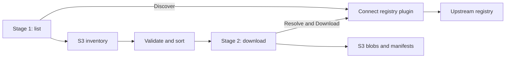

# Registry plugins over Connect

Registry implementations run as independent HTTP services using
[Connect-Go](https://github.com/connectrpc/connect-go). WordPress plugins and themes, Chrome Web Store,
Firefox, GitHub, n8n community nodes, Ansible Galaxy, Obsidian community plugins, and Helm charts are shipped here as independent Go modules. See [workspace boundaries](monorepo.md). The host accepts other implementations of the same protocol
without importing their code or adding registry-specific flags.



## Boundary and ownership

The host owns worker limits, staging files, SHA-256, retry policy,
inventories, ordering, completion manifests, and S3 credentials. A plugin owns upstream authentication,
pagination, artifact resolution, and fetching bytes. The plugin never receives
S3 credentials or filesystem paths from the host. Each bundled plugin also limits
persisted `download_url` attributes to its registry's download hosts, so a tampered
inventory cannot direct the plugin process at arbitrary servers.

Plugins are separately started services. The host connects to an explicit URL;
it does not install, launch, supervise, or execute downloaded plugin binaries.
Run a plugin alongside the host for minimal network overhead, or deploy it as a
remote service. A plugin can be implemented in another language using the same
Protobuf schema and Connect-compatible service.

## Versioned protocol

The source of truth is
[`sdk/proto/dug/registry/v1/registry.proto`](../sdk/proto/dug/registry/v1/registry.proto).
Generated Go messages and Connect interfaces live under `sdk/gen/dug/registry/v1/`.

| RPC | Shape | Purpose |
| --- | --- | --- |
| `Info` | Unary | Return registry identity and protocol major version |
| `Discover` | Server stream | Emit versioned resource references incrementally |
| `Resolve` | Unary | Return a stable revision and complete blob descriptors |
| `Download` | Server stream | Fetch a named blob at a resolved revision |

`plugin.NewClient` checks identity and protocol version before discovery. The CLI
registry argument is the expected identity, so pointing `wordpress` at another
plugin fails immediately. New backward-compatible fields can be added within
`v1`; incompatible changes require a new package and protocol major version.

`Discover` and `Resolve` carry a map of non-secret, plugin-specific query options.
The same options travel with download requests. Unknown options must be rejected
by each plugin rather than silently ignored. The host persists these options in
the stage-one inventory and restores them for stage two. The `wordpress` and
`wordpress-themes` plugins accept:

| Option | Meaning |
| --- | --- |
| `search` | Search query |
| `slugs` | Comma-separated explicit plugin or theme slugs |
| `page_size` | Discovery page size, 1–250; default 100 |
| `browse` | updated (default), popular, or new; themes also accept featured |
| `version_depth` | Positive integer, inclusive YYYY-MM-DD cutoff, or unlimited; default 1 |

`search` and `slugs` are mutually exclusive. The host forwards `--version-depth`
as `version_depth`; plugins without version history should reject it. WordPress
emits a separate reference for each selected version and excludes moving trunk.
Date depth uses original SVN tag creation history and records `released_at`.
Theme releases are version directories under the slug in the theme SVN rather
than tags; the same creation-history rule applies. Chrome accepts:

| Option | Meaning |
| --- | --- |
| `ids` | Comma-separated extension IDs; omitted means public sitemap discovery |
| `listing_concurrency` | Concurrent metadata lookups, 1–128; default 8 |
| `browser_version` | Browser compatibility version; default `150.0.0.0` |
| `details` | Fetch each item's Web Store page for users, rating, category and developer; default `true` |

Chrome discovery uses Google's public sitemap and update manifest service. It
includes public CRX entries such as themes; it is not an exhaustive app catalog.
The update service carries no listing facts, so with `details` on the adapter
also reads each item's store page (one extra request per item, bounded by
`listing_concurrency`): the user count becomes the `installs` fact, the store
category becomes tags, the "Offered by" developer becomes the author, and the
rating (`rating` 0–100, `rating_average` 0–5), rating count (`num_ratings`),
`title` and `category` name go to metadata. The exact numbers come from the
page's embedded item record; the visible text, which rounds, is the fallback.
A removed item's page is missing or empty and simply yields no facts. GitHub accepts:

| Option | Meaning |
| --- | --- |
| `repos` | Comma-separated `owner/name` repositories |
| `owner` | User or organization login to enumerate |
| `search` | Repository search query; discovery partitions `created:` ranges itself |
| `forks` | Include forks when enumerating an owner; default false |
| `assets` | Archive release assets alongside the source archive; default true |
| `snapshot` | Default-branch head policy: fallback (default), always, only, or never |
| `refs` | Extra branches or tags to snapshot for every repository |
| `tags` | Archive every remaining tag as well; default false |
| `version_depth` | Positive integer, inclusive YYYY-MM-DD cutoff, or unlimited; default 1 |

Exactly one of `repos`, `owner`, or `search` is required. GitHub pins each
release tag's commit SHA, release ID, and uploaded asset descriptors at listing
time and derives download URLs from those validated fields during resolution; it
persists no URLs. A `download` attribute records whether a reference uses the
quota-free public hosts (`direct`, public github.com repositories) or API routes
with the token (`api`, private and Enterprise repositories). Authentication is configured in the
plugin process (`GITHUB_TOKEN` for GitHub), not sent as query options or persisted reference attributes.

n8n accepts:

| Option | Meaning |
| --- | --- |
| `packages` | Comma-separated npm package names, scoped (`@scope/name`) or not; explicit packages need not carry the keyword |
| `keyword` | npm keyword to walk; default `n8n-community-node-package` |
| `enumerate` | `all` (default), `search` or `ecosystems`: which indexes list the keyword's packages |
| `version_depth` | Positive integer, inclusive YYYY-MM-DD cutoff, or unlimited; default 1 |

`packages` excludes `keyword` and `enumerate`. n8n needs no credentials. npm has
no listing that can be walked to the end: its search serves only the first 5,000
of a keyword's results, and the ecosyste.ms keyword index lags npm. `all` takes
the union of both, verifies every name against npm, and logs a warning when it
finds fewer packages than npm's search reports; `search` and `ecosystems` use one
index each. Discovery derives each tarball URL from the validated name and version
and persists it with npm's integrity hash (SHA-512, or SHA-1 for old versions);
resolution makes no request and rejects any URL that is not that tarball route on
`registry.npmjs.org`. npm publishes no SHA-256 or size, so the blob carries
neither: the plugin checks the SHA-512 while the tarball streams, and the host
computes SHA-256.

Ansible Galaxy accepts:

| Option | Meaning |
| --- | --- |
| `collections` | Comma-separated fully qualified `namespace.name` collections |
| `namespaces` | Comma-separated namespaces; every published collection in each |
| `page_size` | Index and version-list page size, 1–100; default 100 |
| `version_depth` | Positive integer, inclusive YYYY-MM-DD cutoff, or unlimited; default 1 |

`collections` and `namespaces` are mutually exclusive; with neither, discovery
walks the whole catalog of published collections. Galaxy needs no credentials.
Discovery pins the artifact URL, SHA-256 and size from each version's own
document, so resolution makes no request and rejects any URL that is not the
`artifacts/NAMESPACE-NAME-VERSION.tar.gz` route on the Galaxy host.

Helm charts accept:

| Option | Meaning |
| --- | --- |
| `charts` | Comma-separated `REPOSITORY/CHART` names, as Artifact Hub names them |
| `repos` | Comma-separated Artifact Hub repository names; every chart in each |
| `search` | Artifact Hub full-text query, up to 100 characters |
| `version_depth` | Positive integer, inclusive YYYY-MM-DD cutoff, or unlimited; default 1 |

`charts` cannot be combined with `repos` or `search`; with none of them, discovery
walks every chart Artifact Hub indexes, deprecated ones included. Helm needs no
credentials. Artifact Hub hosts no bytes, so discovery pins each version's
download URL, the repository URL and the SHA-256 that the repository's `index.yaml`
published; resolution makes no request. It accepts a download URL only over HTTPS to
a public DNS name on the repository URL's own host or a GitHub release host
(`github.com`, `codeload.github.com`, `raw.githubusercontent.com`). The repository URL
is part of the persisted descriptor, so this rule narrows what an edited inventory can
make the plugin fetch to named public hosts but cannot make a chosen host impossible;
run the plugin without access to internal networks. Charts published to `oci://`
registries are skipped.

## Streaming and retries

Discovery streams one reference at a time. The client waits for the host's
inventory-writer callback before receiving the next reference. Backpressure propagates through
HTTP flow control; HTTP buffers may let the producer get slightly ahead. Ending
discovery early, including `--limit`, cancels the remote stream.

Downloads send nonempty chunks of at most 256 KiB, starting at byte zero. Memory
use is bounded by active streams, not artifact size. The client exposes each
stream as an `io.ReadCloser` for the existing engine. Closing it or cancelling
its context cancels the RPC and upstream read. RPC gzip is disabled by the host
because archive formats are already compressed.

Successful end-of-stream is required before a transfer can be committed. Connect
error trailers are propagated as read errors even when payload bytes were
received first. The engine discards an interrupted staging file and starts a new
download attempt at byte zero. Downloads do not support byte-range resume.

The Go server bridge is stateless: `Download` calls `Resolve` again, verifies the
requested revision still matches, and opens the requested blob by its unique
name. Blob names must be stable across repeated resolutions. A changed revision
returns `failed_precondition`; rerun discovery to get the new revision. The bridge
does not keep an unbounded map of closures or expiring download handles. This
trades an extra metadata resolution for restart-safe operation; WordPress's
resolution uses the download URL already present in the reference.

Metadata messages are limited to 24 MiB. Expected hashes and sizes, when supplied,
are checked by the host. WordPress supplies no archive hash, so the host hashes
the received bytes for content addressing rather than publisher authentication.
Transient stream failures are retried by the engine; a plugin's `retry.Permanent`
error arrives as `failed_precondition` and is not retried. Discovery stream failures
discard the unpublished inventory; rerunning stage one re-enumerates. A
completed inventory can be reused by stage two without any discovery calls.
Chrome supplies both expected hash and size and resolves the saved descriptor
without querying the live update service again. GitHub supplies asset sizes and,
when GitHub recorded them, asset SHA-256 digests; source archives are hashed by
the host. Public github.com blobs download from codeload and release download
hosts without a token; private blobs are one API request each that redirects to
a download host, and the bearer token is not forwarded across that redirect.

## Implement a Go plugin

Implement `registry.Registry` with `Discover` and `Resolve`. Standalone commands
use `github.com/rezen/dug/sdk/services/pluginhost` for shared startup:

```go
func main() {
    pluginhost.Main(pluginhost.Command{
        Provider:       myregistry.Provider(),
        Registry:       "my-registry",
        DefaultAddress: "127.0.0.1:7786",
        Factory:        myregistry.PluginFactory,
    })
}
```

The provider is a `registry.Provider` declaring one or more `registry.Definition`
values; it must include the selected registry ID. The factory takes a shared
`*http.Client` and returns a `plugin.Factory`.
The service handles `--listen`, `--connections`, `--help`, `DUG_PLUGIN_TOKEN`,
SIGINT/SIGTERM, HTTP client cleanup, and server errors. Optional `ConfigureFlags`
and `Validate` hooks add source-specific settings, such as GitHub's `--api`.
For embedding, `Command.Run(ctx, args, stderr)` returns an error without exiting
the process or installing signal handlers.

For a custom server, expose the handler directly:

```go
handler, err := plugin.NewHandler(plugin.ServerOptions{
    Registry: "my-registry",
    Factory: func(options map[string]string) (registry.Registry, error) {
        // Validate query options; reuse a concurrency-safe HTTP client.
        return newMyRegistry(options)
    },
    Token: os.Getenv("DUG_PLUGIN_TOKEN"),
})
if err != nil {
    return err
}
```

Serve this handler with `net/http`, or use the SDK
`plugin.Serve(ctx, address, options)` helper for graceful shutdown and stream-safe defaults. Factories and adapter resolution may be called
concurrently. `Blob.Open` must use its own transfer context, since resolution's
context is already cancelled. The generated `RegistryServiceHandler` interface
is also available for plugins needing a custom implementation of the wire service.

The host consumes all plugins through `plugin.Client`, which itself implements
`registry.Registry`. Neither `engine` nor `services/storage` depends on Connect or a
particular adapter. Executables are owned by each source module under `sources/NAME/cmd/dug-NAME`;
a module that serves several registry identities adds one executable per identity, such as
`sources/wordpress/cmd/dug-wordpress-themes`.
All shared Go imports use `github.com/rezen/dug/sdk/...`. The host and sources
share the SDK but do not import each other.

## Deployment

WordPress plugins bind to `127.0.0.1:7781`, Chrome to `127.0.0.1:7782`, Firefox to `127.0.0.1:7783`, GitHub to
`127.0.0.1:7784`, WordPress themes to `127.0.0.1:7785`, n8n to `127.0.0.1:7786`, Ansible Galaxy to
`127.0.0.1:7787`, Obsidian to `127.0.0.1:7788`, and Helm to `127.0.0.1:7789` by default. Set the same
`DUG_PLUGIN_TOKEN` on the host and plugin to enable bearer authentication; the host only sends it to
`https://` or loopback plugin URLs. For a remote deployment, terminate TLS at a proxy and allow long-lived streaming
responses without response buffering. The supplied server uses HTTP/1.1 Connect;
it does not configure plaintext HTTP/2 for gRPC clients. Generated service handlers
can also be hosted with TLS/HTTP2 by other deployments.

The host's `--downloads` controls simultaneous remote downloads. Each plugin's
`--connections` controls its upstream HTTP connection pool. When multiple hosts
share a plugin, each host's worker limit is independent; use deployment-level
limits if aggregate concurrency must be capped. Plugin endpoints are trusted
services, not a sandbox for untrusted code or untrusted request senders.

## Generate and verify

Generated code is checked in; ordinary builds need only Go. To regenerate:

```sh
just generate
just check
```

The script installs pinned Buf, protoc-gen-go, and protoc-gen-connect-go versions
in a temporary directory. `buf lint` checks the schema. To check a future change
against a prior schema snapshot, run `buf breaking --against <baseline>`.

The integration tests exercise the real Connect HTTP protocol, engine archival
and resume, partial-body failures, discovery and download cancellation, bearer
authentication, and revision drift. These fixtures need loopback sockets but no
external services.

## Inventory boundary

`registry.Registry` embeds `Lister` (Discover) and `Resolver` (Resolve).
`inventory.Create` consumes a Lister and publishes a checksummed JSONL object only
after successful listing. `inventory.Open` validates it and creates a disk-backed
ordered iterator. `engine.Download` accepts that iterator and a Resolver; it has
no discovery dependency. `sync` uses the same APIs sequentially.

`Reference.Attributes` holds stable resolution inputs (such as a versioned URL).
`Reference.Facts` and `Reference.Metadata` carry mutable listing facts for
ordering and filtering; both are excluded from completion-manifest identity.

`Facts` is typed and registry-independent: `Downloads` and `VersionDownloads`
(`registry.DownloadStats` with nullable `Total`, `Day`, `Week`, `Month`,
`Quarter`, `Year` counts over trailing windows ending at listing time),
`Installs`, `Repository` (canonical URL from `registry.NormalizeRepositoryURL`,
optional subdirectory and commit, and a `Source` of `registry`, `declared` or
`attested`), `ReleasedAt` and `UpdatedAt`. Every field is a pointer: nil means
the registry does not publish that fact, zero means it reported zero, and
adapters must not derive one window from another. Use `registry.Int64`,
`registry.Time` and `Facts.Clone` when emitting; the host validates facts with
`Facts.Validate` on both sides of the wire and addresses them by dotted path
(`registry.FactPaths`) in `--order` and `--where`.

`Reference.Tags` and `Reference.Author` are two more mutable, non-identity
listing facts. Tags are the registry's keywords, topics or category slugs,
passed through `registry.NormalizeTags` (trimmed, lowercase, sorted, unique) so
`--where 'tag = security'` means the same thing in every registry; a reference
with no tags is unknown rather than untagged, so `tag != x` does not match it.
`Author` is a struct naming the publishing account: `Name`, `Username`, `ID`,
`URL`, `Email`, each optional but at least one required. `ID` is the
registry's account identifier that survives renames, so ownership changes show
up when inventories are compared. Filters address it as `author.username`
(alias `author`), `author.name`, `author.id`, `author.url` and `author.email`.
`Reference.ValidateListing` checks facts, tags and author together.

`Metadata` keeps registry-specific metrics as strings: WordPress provides
`rating` (0–100), `num_ratings`, `ratings` (JSON star counts) and individual
`ratings_1` through `ratings_5`, and fills `Downloads.Total`, `Installs`,
`UpdatedAt`, `ReleasedAt` and the item's SVN `Repository` as facts; adapters need
not supply every metric. Ratings and package downloads are plugin-wide snapshot
facts, including on historical references. The theme directory supplies the same
plus `template`, the parent theme slug of a child theme.
Missing values sort last, with original discovery order as the stable tie breaker.

An inventory freezes the observed references, not the upstream service. If an
upstream deletes a saved version, stage two reports failure; it must not silently
replace the saved version with a newer one. Keep query options and both metadata
maps free of secrets, since they are persisted to S3.

`inventory.ParseFilter` compiles AND comparisons against identity fields, typed
facts or metadata.
`inventory.Select` wraps the ordered snapshot iterator and filters before applying
the download limit. Limits count versions, including completion skips. No filter
or download limit changes the persisted source inventory. `sync --limit` applies
to stage two; `sync --list-limit` independently bounds stage one.

Firefox accepts `slugs`, `search`, `page_size` (1–50), and `version_depth`.
It supplies SHA-256, size and version creation dates. Its facts are
`Downloads.Week` (AMO's trailing seven-day count), `Installs` (average daily
users), `UpdatedAt` and `ReleasedAt`; `Downloads.Total` stays nil because AMO
publishes no lifetime count. Metadata keeps `num_ratings`, normalized `rating`
(0–100) and raw `rating_average` (0–5).

Obsidian accepts `ids` and `version_depth`; without `ids` it walks the whole
community catalog. Versions are the plugin's non-draft GitHub releases, newest
first, each archived as `main.js`, `manifest.json` and optional `styles.css`.
Listing pins the repository, release ID and asset descriptors (ID, name, size,
and GitHub's SHA-256 digest when it records one); resolution derives download
URLs from them and makes no request. Its facts are `Downloads.Total` and
`UpdatedAt` from the catalog stats, `VersionDownloads.Total` per release,
`ReleasedAt` (release publication), and `Repository` (declared). `Installs`
stays nil. Metadata keeps `plugin_name`, `repo`, `prerelease`, `asset_count`
and `version_rank`. It reads `GITHUB_TOKEN` through the shared client in
`sdk/services/github`; the catalog has about 10,000 plugins, far more than
60 unauthenticated requests per hour.

GitHub accepts `repos`, `owner`, `search`, `forks`, `assets`, `snapshot`, `refs`,
`tags`, and `version_depth`. It supplies `stars`, `forks`, `open_issues`, `language`,
`license`, `archived`, `fork`, `private`, `kind` (`release`, `snapshot`, or `tag`),
`prerelease` and `asset_count` as metadata. Its facts are `ReleasedAt` (release
publication or commit date), `UpdatedAt` (last push), `Repository` (the
repository's own URL with source `registry` and the archived commit) and, for
releases, `VersionDownloads.Total`, the asset downloads of that one release.
`Downloads` stays nil because GitHub has no repository-wide count.

n8n accepts `packages`, `keyword`, `enumerate`, and `version_depth`. It supplies
npm's integrity hash as the revision and no size. Its facts are `Downloads.Month`
(npm's trailing 30 days, repeated on every version), `UpdatedAt` (the package
document's modified time), `ReleasedAt` (the version's publish time) and a declared
`Repository` with its monorepo directory. `Downloads.Total` and `Downloads.Week` stay
nil, so the built-in `downloads` order has nothing to sort on; order by
`downloads.month`. Tags are the package's keywords and the author is the account that
published that version (username and email). Metadata keeps `version_rank`,
`release_date_source`, `license`, and, only when true, `install_script` (a
preinstall, install or postinstall script), `deprecated` and `provenance` (a build
attestation). npm publishes no ratings or install base.

Ansible Galaxy accepts `collections`, `namespaces`, `page_size` (1–100), and
`version_depth`. It supplies SHA-256, size and version creation dates. Its facts
are `Downloads.Total` (the collection's lifetime download count, repeated on every
version), `UpdatedAt`, `ReleasedAt` (the version's upload time) and a declared
`Repository` with the build commit when the tarball names one. Tags come from the
collection's galaxy.yml tags and the author is the namespace. Metadata keeps
`deprecated`, `requires_ansible`, `license` and `marks`. Galaxy publishes no
ratings or install base, so those stay absent.

Helm charts supply SHA-256 but no size. Their facts are `UpdatedAt` (the current
version's publish time, repeated on every version), `ReleasedAt` (the version's
publish time as the repository recorded it) and a declared `Repository` taken from
the chart's source link. Tags are the chart's keywords and its Artifact Hub category,
and the author is the repository's organization or user. Artifact Hub publishes no
download counts or install base, so `Downloads` and `Installs` stay nil. Metadata keeps
`stars` (search results only, so explicit `charts` lack it), `repository`, `official`,
`verified_publisher`, `cncf`, `category`, `app_version`, `license`, `prerelease`,
`deprecated`, `signed`, `version_rank` and `release_date_source`.
